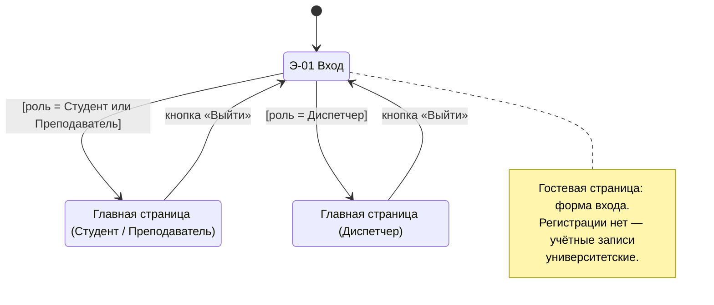
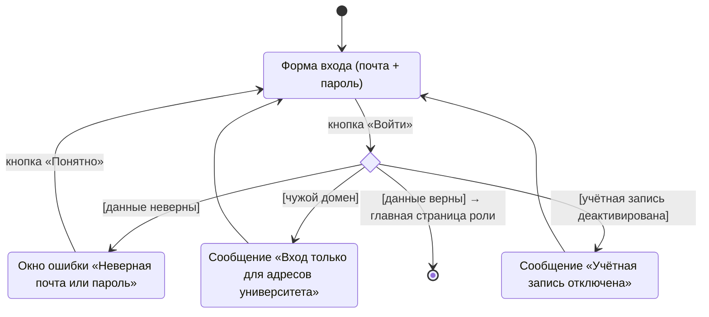
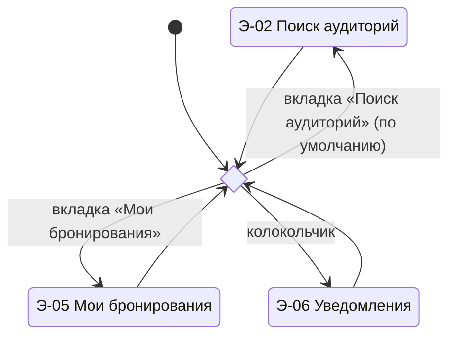
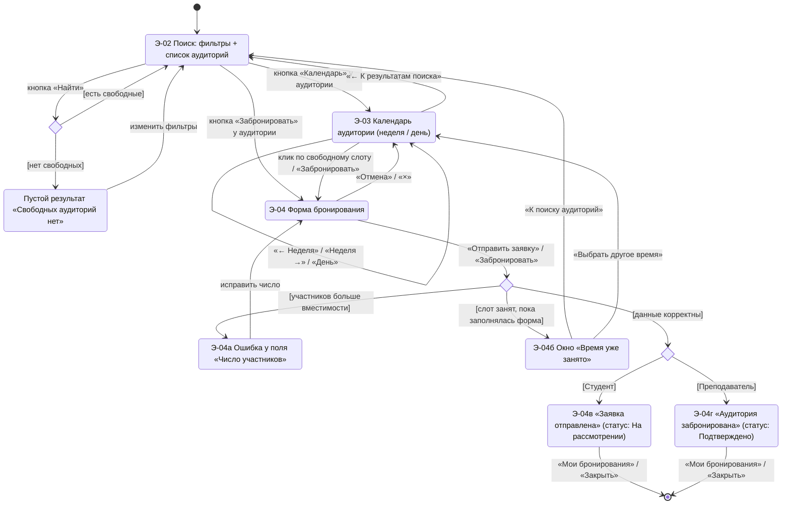
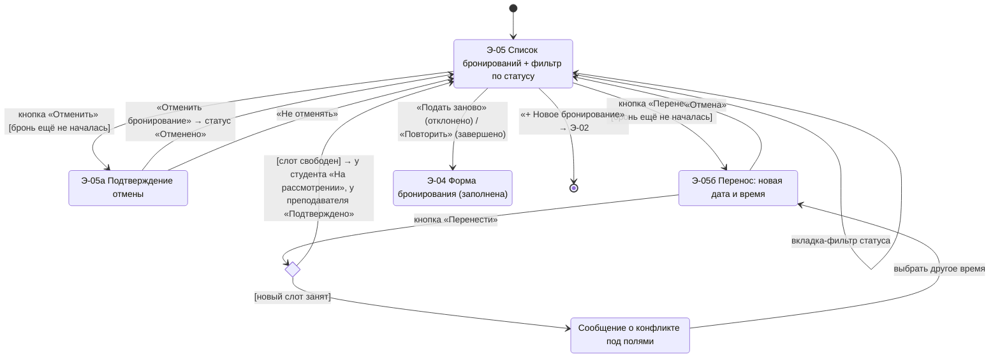
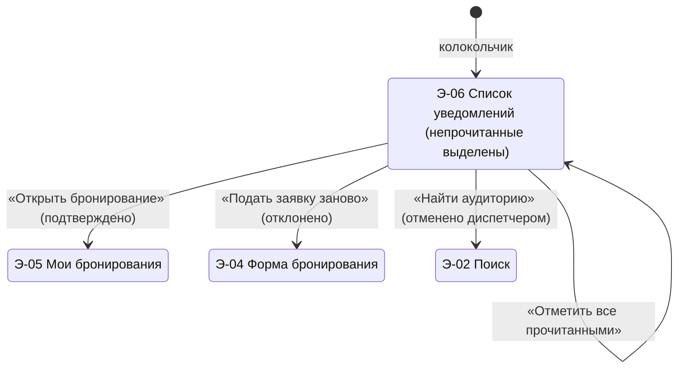
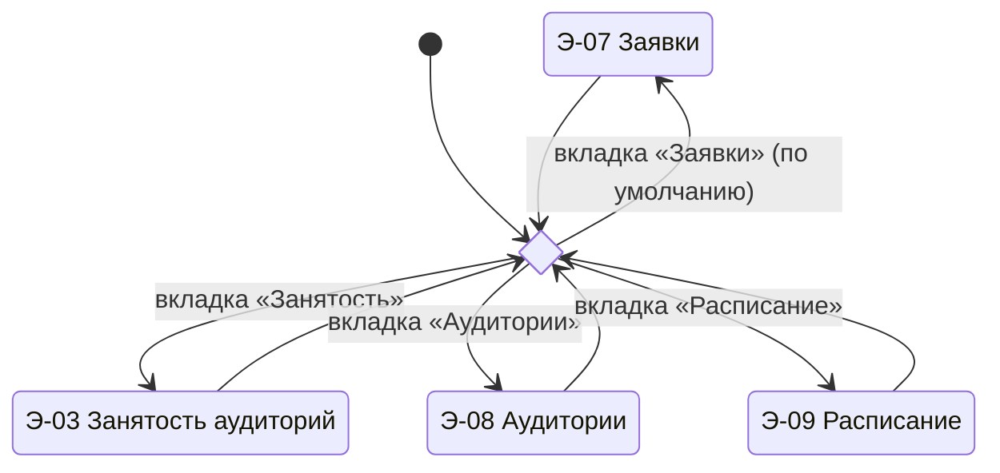
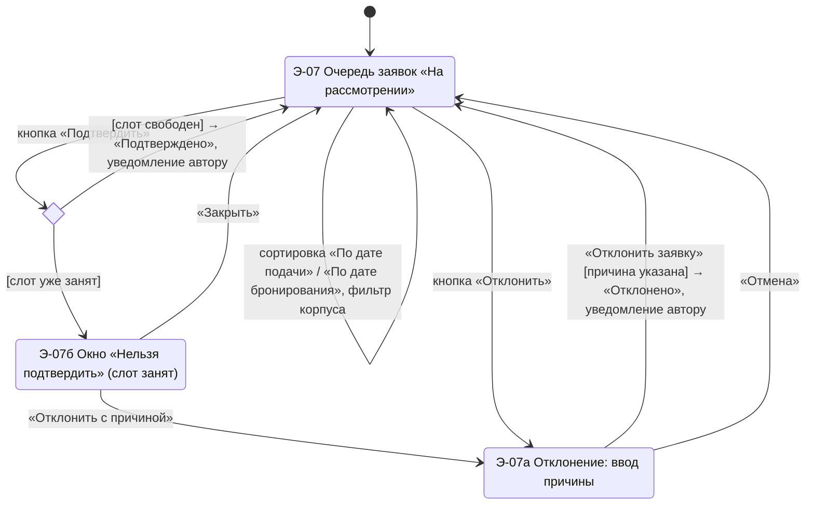
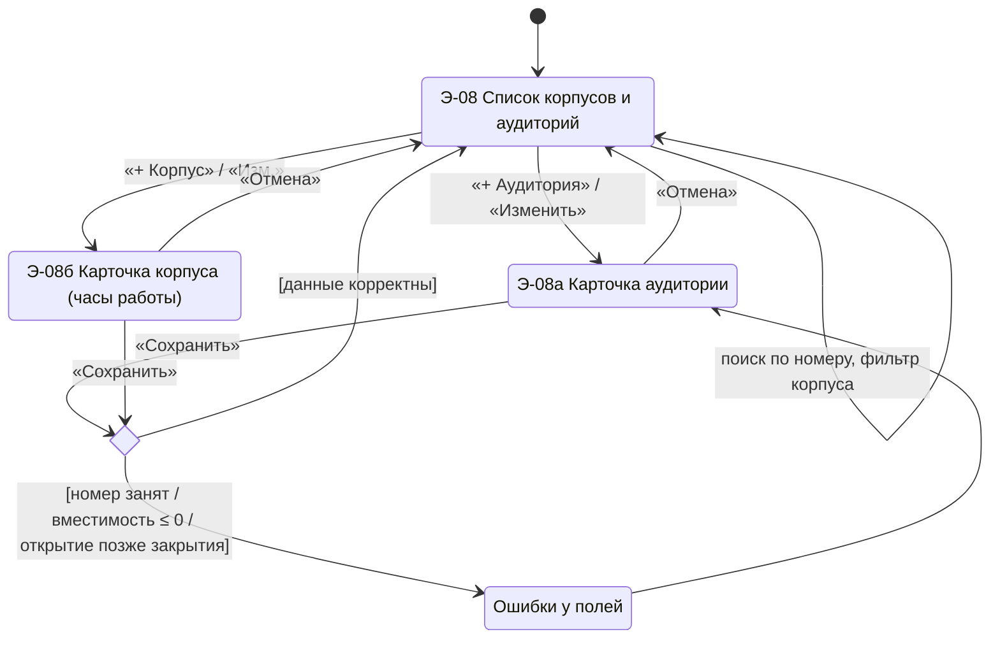
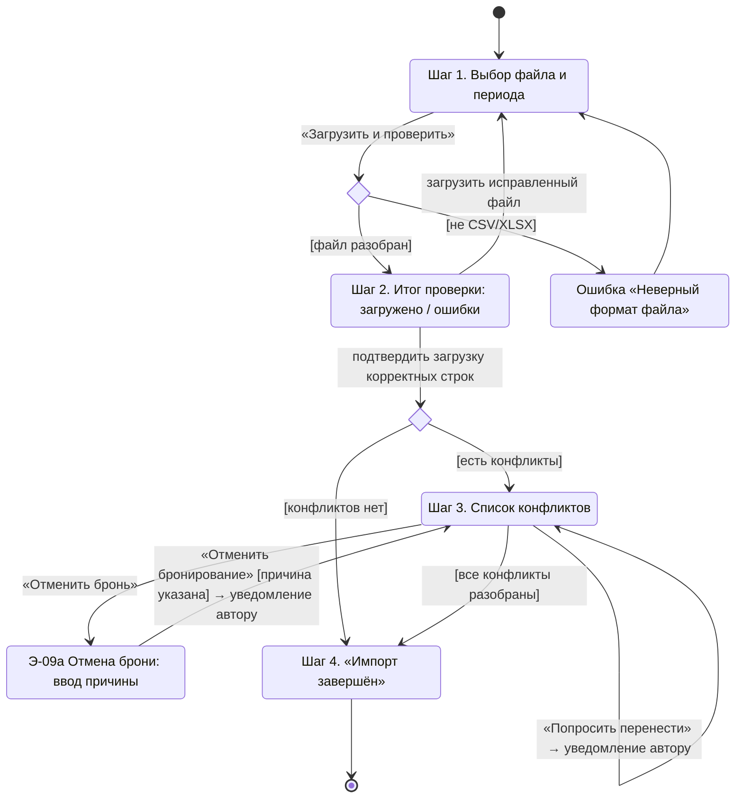

# Навигация

Навигация RoomBook описана диаграммами состояний (state machine): состояние — экран или модальное окно, переход — действие пользователя (кнопка, вкладка) или результат проверки системой (в квадратных скобках).
Номера экранов (Э-01…Э-09) совпадают с документом [Пользовательский интерфейс](Пользовательский%20интерфейс.md), номера вариантов использования — с [Варианты использования](../03-Системный%20аналитик/Варианты%20использования.md).

## 1. Карта экранов

| № | Экран | Роль | UC |
|---|---|---|---|
| Э-01 | Вход | все | UC-01 |
| Э-02 | Поиск свободной аудитории | Студент, Преподаватель | UC-03 |
| Э-03 | Календарь занятости аудитории | все | UC-02 |
| Э-04 | Форма бронирования (модальное окно) | Студент, Преподаватель | UC-04 |
| Э-05 | Мои бронирования | Студент, Преподаватель | UC-05, UC-06, UC-07 |
| Э-06 | Уведомления | все | UC-12 |
| Э-07 | Очередь заявок | Диспетчер | UC-08 |
| Э-08 | Аудиторный фонд | Диспетчер | UC-09 |
| Э-09 | Импорт расписания и конфликты | Диспетчер | UC-10, UC-11 |

Общие элементы всех экранов после входа: шапка с логотипом (ведёт на стартовый экран роли), вкладки разделов, колокольчик уведомлений со счётчиком непрочитанных, имя и роль пользователя, кнопка «Выйти».

## 2. Интерфейс в целом

Диаграмма не имеет конечного состояния: это веб-приложение, между разделами можно переключаться сколько угодно. Выход из системы возвращает на экран входа.

## 3. Э-01. Вход

## 4. Главная страница — Студент / Преподаватель

Вкладки в шапке: **Поиск аудиторий** (стартовая) и **Мои бронирования**; колокольчик открывает **Уведомления**.

### 4.1. Поиск и бронирование (Э-02 → Э-03 → Э-04)

### 4.2. Мои бронирования (Э-05)

### 4.3. Уведомления (Э-06)

## 5. Главная страница — Диспетчер

Вкладки в шапке: **Заявки** (стартовая), **Занятость** (Э-03 с выбором аудитории), **Аудитории**, **Расписание**.

### 5.1. Заявки (Э-07)

### 5.2. Аудитории (Э-08)

### 5.3. Импорт расписания (Э-09)

## 6. Правила навигации

- Модальные окна (Э-04, Э-05а/б, Э-07а/б, Э-08а/б, Э-09а) открываются поверх текущего экрана; закрываются кнопкой «Отмена», «×» или клавишей Esc — пользователь остаётся на том же экране.
- Действия, которые нельзя вернуть (отмена бронирования, отклонение заявки), всегда требуют подтверждения в модальном окне.
- После успешного действия пользователь остаётся в том же разделе, список обновляется, показывается короткое сообщение об успехе.
- Кнопки «Отменить» и «Перенести» не показываются у бронирований, время начала которых наступило (UC-06, исключение).
- Прямой переход по адресу на экран чужой роли (например, студент открывает «Заявки») возвращает на стартовый экран своей роли (NFR-10).
